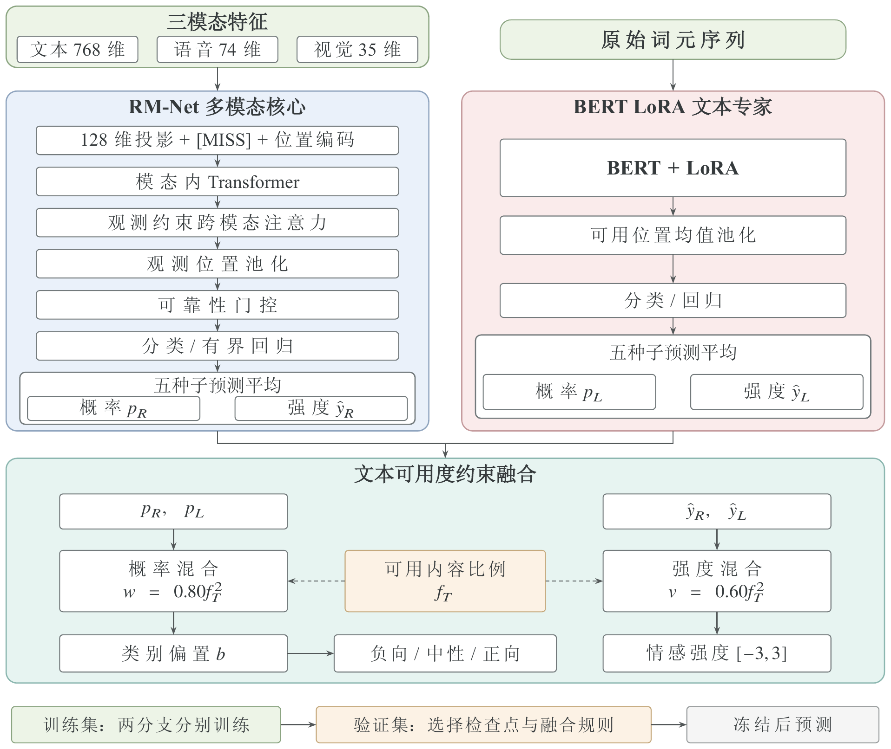
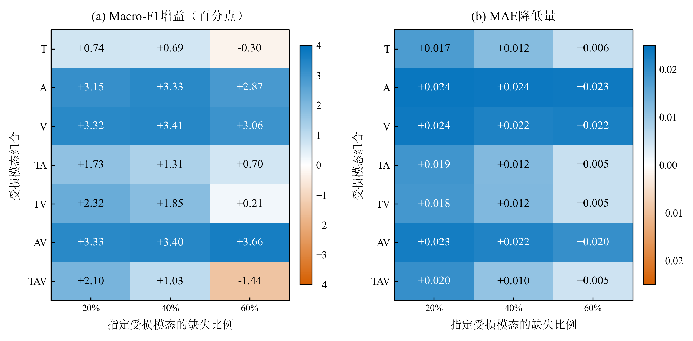
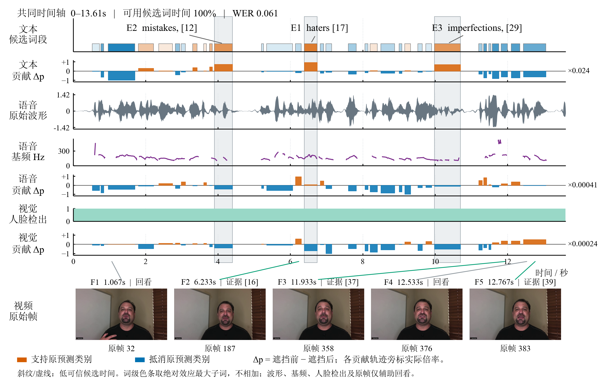

**English (default)** | [简体中文](README.zh-CN.md)

<div align="center">
  <a href="https://github.com/rudykon/EmoMosaic">
    <picture>
      <source media="(prefers-color-scheme: dark)" srcset="assets/readme/emomosaic-horizontal-dark.svg">
      <source media="(prefers-color-scheme: light)" srcset="assets/readme/emomosaic-horizontal.svg">
      
    </picture>
  </a>
  <p><strong>Multimodal sentiment prediction with partially missing modalities</strong></p>
  <p>Text · Audio · Vision<br>RM-Net · BERT LoRA text experts · Availability-gated fusion</p>
  <p>
    <a href="https://huggingface.co/config-h/EmoMosaic"></a>
    <a href="https://huggingface.co/datasets/config-h/EmoMosaic"></a>
    <a href="requirements.txt"></a>
    <a href="requirements.txt"></a>
    <a href="LICENSE"></a>
  </p>
  <p>
    <a href="https://rudykon.github.io/EmoMosaic/app.html"><strong>Demo App ↗</strong></a> ·
    <a href="https://rudykon.github.io/EmoMosaic/inference.html"><strong>Online Inference ↗</strong></a>
  </p>
  <p>
    <a href="#overview">Overview</a> ·
    <a href="#try-it">Try it</a> ·
    <a href="#method">Method</a> ·
    <a href="#results">Results</a> ·
    <a href="#quick-start">Quick start</a> ·
    <a href="#reproduction">Reproduction</a>
  </p>
</div>

**EmoMosaic** combines a five-seed **RM-Net** ensemble with five **BERT LoRA** text experts to predict sentiment class and continuous intensity from text, audio and visual features. Fusion weights adapt to the fraction of available text, reducing the text expert's influence when its evidence is missing.

This repository contains source code, configuration, tests, project website assets and selected figures for the README. **Model weights and data are hosted on Hugging Face**; the manuscript, experiment outputs and generated caches are maintained separately.

**Project website:** [Build, preview and GitHub Pages setup](website/README.md). The site reuses the original EmoMosaic layout, with bilingual navigation, results and browser inference.

<a id="overview"></a>
## 🧩 Overview

| Component | What it does | Explore |
| --- | --- | --- |
| **Multimodal prediction** | Combines text, audio and vision with explicit missingness handling | [Model and inference](code/src/p2p3/README.md) |
| **Text experts & fusion** | Supplements RM-Net with BERT LoRA predictions, gated by text availability | [Frozen predictor](code/src/p2p3/improved_predict.py) |
| **Dual-target explanations** | Measures modality contributions and local masking effects for class probability and intensity | [Explanation engine](code/src/p2p3/p3_fusion.py) |
| **Features & alignment** | Extracts audio/video features and builds word-level time alignment | [Alignment pipeline](code/src/problem1/README.md) |
| **Reproducible assets** | Restores pinned model and data releases with checksum verification | [Model manifest](scripts/model_release.json) · [Data downloader](scripts/download_data.py) |

<a id="try-it"></a>
## 🌐 Try EmoMosaic

| Experience | What you can do |
| --- | --- |
| [**Demo App →**](https://rudykon.github.io/EmoMosaic/app.html) | Explore the Android app interface, supported input modalities and deployment notes. |
| [**Online Inference →**](https://rudykon.github.io/EmoMosaic/inference.html) | Run RM-Net + BERT LoRA in your browser with the built-in example, English text or aligned feature JSON. |

Online inference runs on your computer after the model files download; your inputs stay in the browser. The first complete run downloads about **254 MB**, so a desktop browser is recommended.

<a id="method"></a>
## 🧠 Method

RM-Net processes the available multimodal features. BERT LoRA experts provide a complementary text prediction. The two branches are combined using **separate classification and regression weights**, followed by a fixed class-bias correction for classification.

<p align="center">
  <a href="assets/readme/method.png">
    
  </a>
  <br>
  <sub><strong>Overall architecture and explanations</strong> · Current manuscript Figure 1 · Click to enlarge</sub>
</p>

For an available-text fraction `f_T`, the frozen expert weights are `0.80 × f_T²` for classification and `0.60 × f_T²` for regression. When no text is available, both expert weights are zero. Outputs are **negative / neutral / positive** sentiment and a continuous intensity score in **[−3, 3]**.

The architecture figure is exported from the current English manuscript. The historical results and explanation figures retain their original Chinese labels, with English captions and descriptions. See [figure sources](assets/readme/README.md) for the source files and export details.

<a id="results"></a>
## 📊 Reported results

The following results come from the historical frozen evaluation of **RM-Net + BERT LoRA** on the competition-provided CMU-MOSEI data. “Mixed missingness” uses the fixed 40% mixed-missingness evaluation view.

| Split | Input condition | Accuracy ↑ | Macro-F1 ↑ | MAE ↓ | Pearson r ↑ |
| --- | --- | ---: | ---: | ---: | ---: |
| Validation | Full input | 0.6442 | 0.6339 | 0.5652 | 0.6835 |
| Validation | 40% mixed missingness | 0.6497 | 0.6394 | 0.5722 | 0.6638 |
| Test | Full input | **0.6809** | **0.6550** | 0.6099 | 0.6942 |
| Test | 40% mixed missingness | **0.6630** | **0.6341** | 0.6210 | 0.6861 |

Across the two test views, mean Macro-F1 is **0.6446**, compared with **0.6208** for the original RM auxiliary head: a gain of **2.38 percentage points**. Values are rounded from the [original evaluation table](https://github.com/rudykon/EmoMosaic_GMCM2026/blob/50202237f5f38f1e44ee916c596d9ab57a92d94e/outputs/problem2/improvement/final_evaluation/headline_metrics.csv).

> **Evaluation scope:** The historical test split was inspected during development and is not an independent blind test. These are reported results, not a new evaluation run. Attachment 3 is unlabeled, so its predictions cannot be used to calculate accuracy.

<p align="center">
  <a href="assets/readme/missingness-gains.png">
    
  </a>
  <br>
  <sub><strong>Fusion gains under missingness</strong> · Original paper Figure 5.7<br>727 historical held-out samples · T / A / V = text / audio / vision · Positive values indicate improvement</sub>
</p>

The gains vary with the missingness pattern: classification can degrade under severe text loss, including the 60% T and TAV conditions shown above.

<a id="explanations"></a>
## 🔎 Explanation example

For Attachment 4 sample 19, word spans, audio tracks and video frames share a candidate timeline. Local masking measures how each part of the input changes the predicted class probability; the explanation pipeline also supports continuous-intensity attribution.

<p align="center">
  <a href="assets/readme/explanation-sample19.png">
    
  </a>
  <br>
  <sub><strong>Multimodal evidence on a shared timeline</strong> · Original paper Figure 6.13<br>Orange supports the original predicted class; blue opposes it. Waveforms and raw frames provide viewing context.</sub>
</p>

These are output-level masking explanations. They do not establish causal effects or equivalence to deleting raw text before contextual encoding.

<a id="quick-start"></a>
## 🚀 Quick start

Run the following commands from a Unix-like shell with **Python 3.11** and **GNU Make**. The default setup below uses CPU PyTorch.

### 1. Install

```bash
git clone https://github.com/rudykon/EmoMosaic.git
cd EmoMosaic
python3.11 -m venv .venv
.venv/bin/python -m pip install --upgrade pip
.venv/bin/python -m pip install torch==2.6.0 --index-url https://download.pytorch.org/whl/cpu
.venv/bin/python -m pip install -r requirements.txt
```

### 2. Download the pinned resources

```bash
make download-weights
make download-models
make download-data
```

| Command | Resource | Details |
| --- | --- | --- |
| `make download-weights` | [EmoMosaic model release](https://huggingface.co/config-h/EmoMosaic) → `code/models/` | Restores 11 checkpoint/adapter files and required configuration from a pinned revision; verifies SHA-256 and refuses to overwrite mismatched files |
| `make download-models` | BERT, CTC and face models | Downloads pinned upstream assets and verifies checksums; final sentiment prediction uses BERT, while CTC and face models support the separate alignment pipeline |
| `make download-data` | [Existing data release](https://huggingface.co/datasets/config-h/EmoMosaic) → `data/source_data/` | Downloads about **3.80 GiB**, verifies each file and requires no token for public access |

<details>
<summary><strong>Pinned release revisions</strong></summary>

- **Model:** `15af38ee327811dcac3eca397746dba69266854c`; file-level hashes are recorded in [scripts/model_release.json](scripts/model_release.json).
- **Data:** `c9c27b40a226f9f14ae05dde5b8ea4d5ae65ae87`; the downloader restores the existing release without republishing it.

Downloaded weights, data, caches and experiment outputs remain local and are excluded by [`.gitignore`](.gitignore).

</details>

### 3. Predict

```bash
make predict
```

This runs the final frozen predictor on the unlabeled Attachment 3 samples and writes **`validation/attachment3_predictions.csv`**.

<a id="reproduction"></a>
## 🔬 Reproduction

### Rebuild caches and evaluate

After downloading the resources, rebuild the feature caches locally before evaluating:

```bash
.venv/bin/python code/src/p2p3/prepare.py --device cpu
make evaluate
```

The [evaluation entry point](code/src/p2p3/evaluate_deployed.py) compares the frozen fusion model with the RM baseline on validation and test splits, covering full input, 40% mixed missingness and a 21-condition missingness grid. It writes metrics, predictions, protocol metadata and paired classification statistics to a fresh directory under `code/outputs/reproduced/`.

<details>
<summary><strong>Train a new RM-Net run</strong></summary>

With the resources and caches prepared, start a new run using a CUDA-capable PyTorch installation:

```bash
.venv/bin/python code/src/p2p3/train.py --variant A0 --seed 17 --device cuda:0 \
  --run-dir outputs/reproduced/rm_A0_seed17
```

This trains an RM-Net run; reproducing the deployed fusion also requires the text experts and frozen fusion configuration. See the [model guide](code/src/p2p3/README.md).

</details>

<details>
<summary><strong>Set up word-level alignment and numerical explanations</strong></summary>

The independent alignment pipeline has a separate dependency set. Install it in `.venv-p1` after the resource downloads:

```bash
python3.11 -m venv .venv-p1
.venv-p1/bin/python -m pip install -r requirements-alignment.txt \
  --extra-index-url https://download.pytorch.org/whl/cpu
make align-smoke
```

With the resources, caches and alignment environment prepared, run numerical explanations:

```bash
make explain
```

The explanation command skips figure generation and uses the separate alignment environment when word-level alignment must be rebuilt. Set `COLING_ALIGNMENT_PYTHON` if that interpreter is not at `.venv-p1/bin/python`.

**Alignment outputs and the official features consumed by the main predictor are not interchangeable.** See the [alignment guide](code/src/problem1/README.md) for the independent pipeline.

</details>

Historical candidate searches, verification scripts and some plotting tools require additional experiment files that are not bundled in this repository.

<a id="repository"></a>
## 🗂️ Repository guide

```text
EmoMosaic/
├── README.md                    # English landing page (default)
├── README.zh-CN.md              # Chinese version
├── assets/readme/               # Logos, selected figures and provenance
├── code/src/
│   ├── p2p3/                    # Models, training, prediction and explanations
│   ├── problem1/                # Feature extraction and word-level alignment
│   └── common/                  # Shared plotting and archive utilities
├── scripts/
│   ├── download_weights.py      # Pinned model download and SHA-256 verification
│   ├── download_data.py         # Existing data release download and verification
│   └── model_release.json       # Model revision and per-file checksums
├── Makefile                     # Download, prediction, evaluation and test commands
├── requirements.txt             # Main environment
├── requirements-alignment.txt   # Separate alignment environment
└── LICENSE                      # MIT license for original code
```

Downloaded and generated directories such as `code/models/`, `data/source_data/`, `code/outputs/` and `validation/` are created locally.

<a id="checks-and-license"></a>
## ✅ Checks & license

```bash
make test
make check-weights
```

Original code is released under the [MIT License](LICENSE). Data, third-party models and dependencies retain their respective terms; see the [dataset usage conditions](https://huggingface.co/datasets/config-h/EmoMosaic/blob/main/TERMS.md). The method figure comes from the current manuscript; branding and historical figures originate from the [EmoMosaic competition project](https://github.com/rudykon/EmoMosaic_GMCM2026). Sources are recorded in the [asset index](assets/readme/README.md).

<p align="center">
  <a href="#overview">Back to overview ↑</a>
</p>
